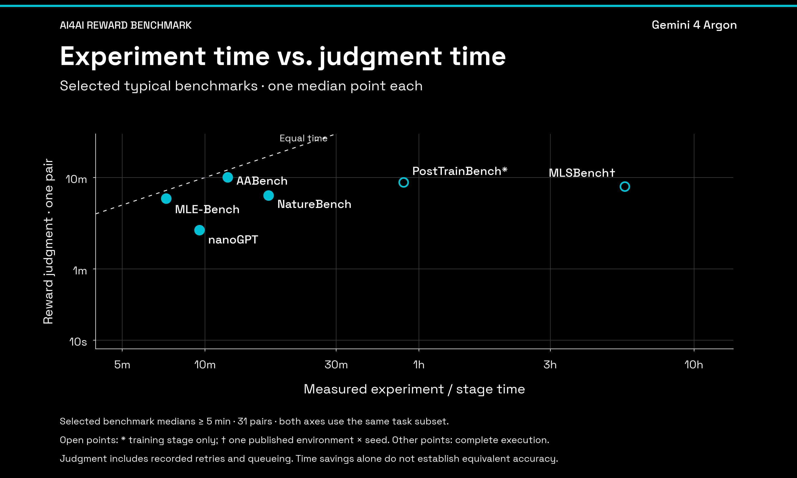
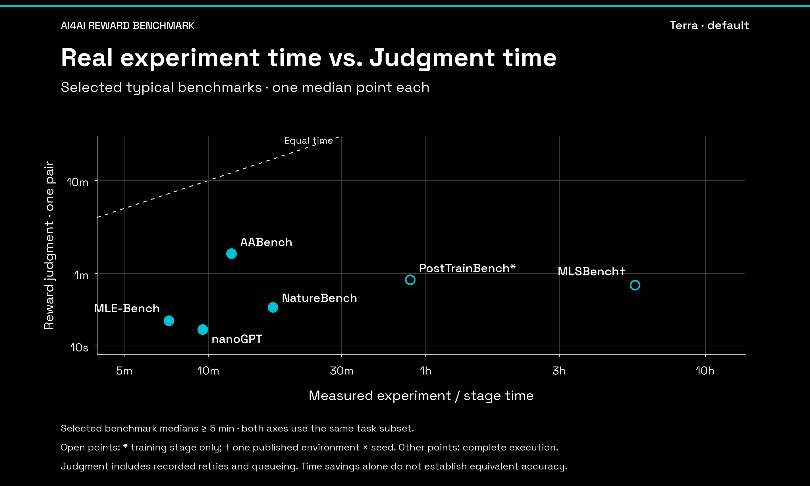
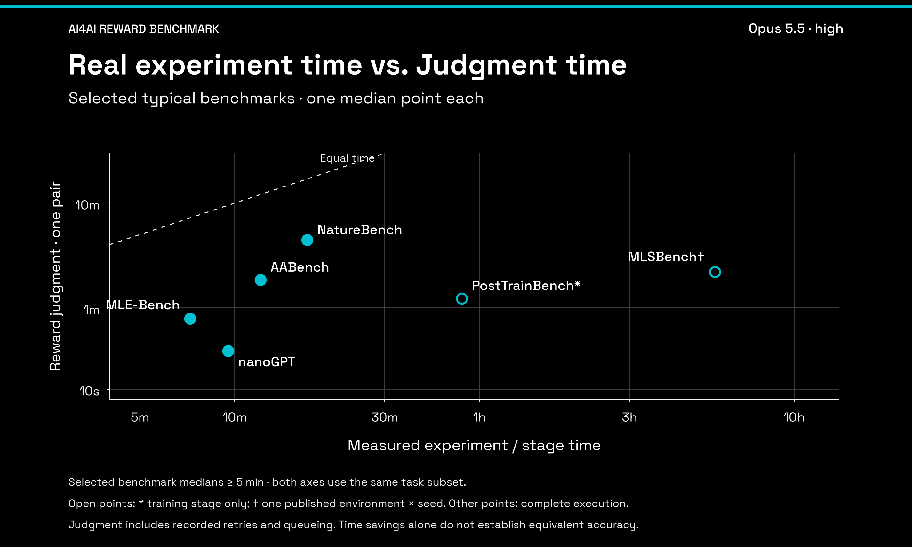
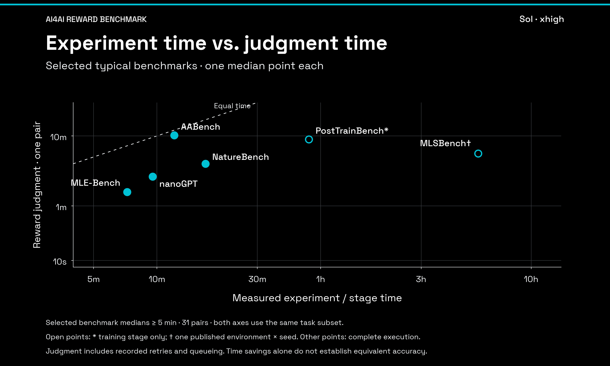

# AI4AI RewardBench

AI4AI RewardBench evaluates whether a model can judge competing algorithmic solutions under a task's conditions, resource constraints, and comparison rule.

[Homepage](https://fuyu12345.github.io/ai4ai-rewardbench/) · [Repository](https://github.com/fuyu12345/ai4ai-rewardbench) · [Evaluation protocol](docs/protocol.md) · [Data notes](data/README.md)

This repository is the **v0.1 homepage with a versioned results update**. It contains a lightweight, responsive website with a mode-filtered leaderboard, benchmark distribution, searchable task catalog, and curated evidence/trace explorer. The visual system follows FRONTIS VI. It has no runtime package dependencies, server database, or model API integration.

## Snapshot

| Item | Count |
| --- | ---: |
| Preference pairs | 135 |
| Source benchmarks | 17 |
| Agent / Reasoning pairs | 105 / 30 |
| Displayed model configurations | 11 |
| Valid / planned cells in displayed rows | 4,454 / 4,455 |
| Curated cases / displayed model–repeat trace records | 3 / 45 |

The frozen collection was initially evaluated on 10–11 November 2026, with the displayed model configurations updated on 12 November. It is a manually selected development collection with historical labels, not an independently sampled hidden test set. The current results measure agreement with frozen preferences; preference reversal, reward-model training, and downstream research gains remain future work.

## Time cost on selected typical benchmarks

These points are **selected typical benchmarks**: six longer-running task slices,
with one median point per benchmark. They illustrate the cost
trend and are **not a representative sample of all 17 benchmarks or all tasks**.
The selection keeps measured benchmark medians of at least five minutes,
independently of judgment speed or accuracy. All four models use the same pairs.

[Switch models on the homepage](https://fuyu12345.github.io/ai4ai-rewardbench/#runtime)
· [Timing definitions and scope](docs/runtime.md)
· [Download the values](data/public-runtime.csv)

Filled points cover complete candidate execution. Open points mark
**PostTrainBench: training only** and **MLSBench: one environment × one seed**.
Judgment time includes recorded retries and queueing; hardware and batch
conditions differ. Timing alone does not establish equivalent accuracy or
downstream research gains.

### Gemini 4 Argon



### Terra · default



### Opus 5.5 · high



### Sol · xhigh



## Run locally

Requirements: Node.js 20.11 or later, npm, and Python 3. No `npm install` step is needed.

```bash
npm test
npm run build
npm run dev
```

Open the printed local URL, normally `http://127.0.0.1:4173`. Set `PORT` to choose another port. The development command serves `dist/`; rerun `npm run build` after editing source or data, then refresh the browser.

The build creates a self-contained `dist/index.html` with inline CSS, JavaScript, and data. The page can also be opened directly from disk. Keep the other generated files beside it for the protocol and JSON download links to work. Any static host can serve the contents of `dist/`.

## Publish to GitHub Pages

The primary homepage is **https://fuyu12345.github.io/ai4ai-rewardbench/**. Every push to `main` runs the checks, builds `dist/`, and publishes that directory through [the Pages workflow](.github/workflows/pages.yml). The workflow can also be started manually from the repository's Actions tab. GitHub Pages uses **GitHub Actions** as its publishing source; no generated files need to be committed.

Page links and downloads use relative paths so the site works under `/ai4ai-rewardbench/`. The existing [Sites deployment](https://ai4ai-rewardbench-v01.candid-book-7348.chatgpt.site) remains available as a previous hosted copy; GitHub pushes update the Pages site.

## What is included

- `data/public-benchmark.json`: 135 task metadata records, benchmark counts, model scores, mode and benchmark breakdowns, cumulative resource metrics, baseline definitions, and source fingerprints.
- `data/public-cases.json`: three case studies with source references, 45 inspected model–repeat records, and 44 saved final explanations, including the documented refusal. Model predictions are not reference labels.
- `data/public-tasks.json`: English presentations of all 135 tasks, including background, question, candidates, constraints, decision rule, and public input inventory.
- `data/public-runtime.json` / `.csv`: matched median times for four models on six selected typical benchmarks; no raw trajectories or reference labels.
- `web/src/`: the HTML template, styles, and browser interactions.
- `scripts/build.mjs` and `scripts/serve.mjs`: dependency-free static build and local server.
- `scripts/prepare_data.py`: allowlisted export and exact-rational aggregate scoring from an authorized frozen handoff.
- `tests/`: score, coverage, ranking, task-catalog completeness, rationale attribution and publication-boundary checks.
- `docs/`: the [protocol](docs/protocol.md), [case provenance](docs/case-provenance.md), and [homepage references](docs/references.md).

Full candidate packages, datasets, private reference labels, organizer evidence, and the complete raw trajectory collection are **not included**. The clickable task catalog contains adapted/translated task statements and source-referenced descriptions. Case evidence distinguishes authored observations from actual final model explanations, evidence claims, uncertainties, and selected public assistant messages. Unreturned or encrypted intermediate reasoning is not reconstructed. It is not a full raw-log replay.

## Read the leaderboard correctly

Every question has equal weight. Each model is evaluated over three scheduled repeats per task. The updated cohorts are:

| Configuration | Overall avg@3 | Agent | Reasoning |
| --- | ---: | ---: | ---: |
| gpt-6.1-sol · xhigh | 178/405 = 43.95% | 126/315 = 40.00% | 52/90 = 57.78% |
| gpt-6.1-terra · default | 173/405 = 42.72% | 116/315 = 36.83% | 57/90 = 63.33% |
| claude-opus-5-5 · high | 163/405 = 40.25% | 106/315 = 33.65% | 57/90 = 63.33% |

All 1,215 cells in these three cohorts are valid. The delivery assigns a common repeat 1–3 index across original and recovery batches; original directory repeat numbers are not always the delivery repeat numbers. All three repeats are included, without choosing a best run or splitting a model into separate provider rows. The new Sol and Terra averages replace their previous single-repeat display.

The other eight configurations retain their original three-repeat averages. **Claude Sonnet** / AAB15-P016 uses repeats 1 and 3 because repeat 2 remained a refusal. Its score is 47/135 = 34.8148%, not pooled 140/404. This exception does not apply to Opus. Effort settings, provider routes and recovery budgets still differ.

Overall baselines remain 33.33% for uniform A/B/tie, 49.26% for random A/B and 57.78% for always-A. Mode tabs use their own denominators and corresponding baselines. Resource totals include original and recovery attempts for each displayed cohort; mean Agent turns divide by 315 planned Agent cells. The cost column sums known explicit CNY charges, with partial coverage where some responses do not report costs; unknown charges are not zero and currencies are not combined.

See the [protocol](docs/protocol.md) for exact policies, limitations and cohort definitions. The unchanged original results snapshot remains in `data/snapshots/golden2-20261111.json`.

## Rebuild the data export

The website and tests work with the included public snapshot. Re-exporting the benchmark data requires separately authorized access to the frozen internal handoff:

```bash
python3 scripts/prepare_data.py --handoff /path/to/authorized-handoff
python3 scripts/merge_delivery.py --help
python3 scripts/prepare_tasks.py --help
python3 scripts/enrich_delivery_cases.py --help
npm test
npm run build
```

The frozen exporter validates the original accepted-repeat matrix and writes the preserved snapshot. The delivery merger validates all three complete model cohorts and emits the updated leaderboard with repeat metadata and all-attempt resource accounting. Task and case exporters have separate source roots and provenance checks; see their help and documentation. It makes no model API calls and does not execute candidates. The source hashes identify the input bytes without distributing private files. Curated cases have a separate extraction and verification record in [case provenance](docs/case-provenance.md).

This is offline score reproduction, not a portable implementation of the historical evaluation runner. A fresh end-to-end model evaluation requires separately versioned runner code, adapters, and authorized task assets. Dataset changes or changed evaluation conditions require a new version instead of overwriting Golden2 results.

## License and release scope

Code and data licensing have not yet been selected. No open-source or dataset license is granted by this repository. The availability of metadata, source references, or an upstream manifest does not confer redistribution rights over candidate code, datasets, models, or calibration assets. See [NOTICE](NOTICE). Full input and trajectory releases remain separate decisions.
